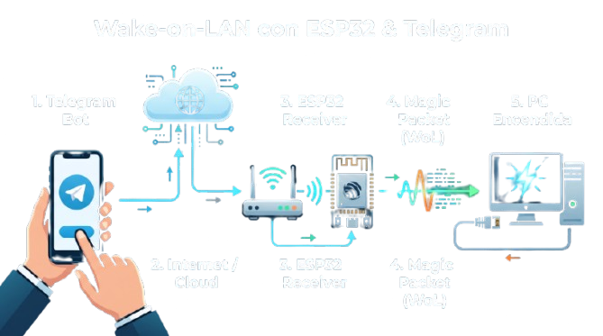

# Wake-on-LAN con ESP32 y Telegram

Este proyecto usa un **ESP32 conectado a Wi-Fi** para recibir `/wake` desde un bot de Telegram y enviar un paquete Wake-on-LAN a la tarjeta de red de una PC. El teléfono puede estar fuera de casa: Telegram entrega el comando por internet, mientras que el ESP32 **debe permanecer en la misma red local** que la PC. La imagen inicial resume esa ruta; el paquete no pasa directamente del teléfono a la PC.

El repositorio incluye el sketch Arduino, una plantilla de configuración y capturas que explican la preparación de la PC y del bot. Los valores de Wi-Fi, token, identificador de chat, MAC y broadcast se completan en un archivo local excluido de Git. La [guía de instalación](docs/CONFIGURACION.md) desarrolla cada paso; el [flujo técnico](docs/FUNCIONAMIENTO.md) explica el código y los límites de la confirmación de encendido.

## 1. Preparar la PC que se quiere encender

La PC necesita una tarjeta de red compatible con Wake-on-LAN, alimentación de espera y una conexión que permita recibir el paquete. En la BIOS/UEFI, busca opciones como **Power On By PCI Devices**, **Power On By PCIE Devices** o **Wake on LAN** y habilita las que correspondan al adaptador. Los nombres cambian según la placa; la captura siguiente muestra **un ejemplo** con las dos primeras habilitadas.

En Windows, revisa en las propiedades del adaptador Ethernet las opciones **Wake on Magic Packet** y el permiso para reactivar el equipo. Obtén la **MAC del adaptador Ethernet que permanecerá conectado**, no la MAC Wi-Fi del ESP32. Prueba primero desde suspensión dentro de la LAN: el encendido desde apagado completo depende de la placa, el adaptador y el estado de energía. El [paso a paso](docs/CONFIGURACION.md#1-configurar-la-pc) detalla cómo comprobarlo. Microsoft explica que el [inicio rápido/apagado híbrido puede impedir WoL](https://learn.microsoft.com/en-us/troubleshoot/windows-client/setup-upgrade-and-drivers/wake-on-lan-feature) en algunos estados.

## 2. Crear el bot de Telegram

Abre [@BotFather](https://t.me/BotFather), ejecuta `/newbot` y elige un nombre y un usuario terminado en `bot`. BotFather te entrega un **token de acceso**; guárdalo únicamente en `WoL/config.local.h`. La captura editada muestra el punto en que se obtiene el token, con **toda la línea del token tapada**.

Telegram indica que ese token permite controlar el bot y puede revocarse desde BotFather. Como el sketch y una captura originales de esta carpeta mostraban el token, **renuévalo antes de usar esta publicación**; después actualiza sólo el archivo local. [Instrucciones oficiales de BotFather](https://core.telegram.org/bots/features#botfather).

## 3. Preparar el ESP32 y la configuración local

1. Instala Arduino IDE, el soporte de placas **ESP32 by Espressif Systems**, la biblioteca [Universal Arduino Telegram Bot](https://github.com/witnessmenow/Universal-Arduino-Telegram-Bot) y su dependencia **ArduinoJson**. `WiFi`, `WiFiClientSecure` y `WiFiUdp` vienen con el núcleo ESP32.
2. Copia `WoL/config.local.example.h` a `WoL/config.local.h`. Este último archivo está ignorado por Git. Completa `WIFI_SSID`, `WIFI_PASSWORD`, el **token nuevo** en `BOT_TOKEN`, la MAC Ethernet de la PC en seis bytes `PC_MAC_BYTES` y la dirección de broadcast local en `WOL_BROADCAST_IP`.
3. Deja `ALLOWED_CHAT_ID` vacío **sólo durante el emparejamiento**. En ese estado el sketch responde a `/id`, pero rechaza `/wake`, `/status` y los demás comandos. Envía `/id` en un chat privado con el bot; copia el número recibido a `ALLOWED_CHAT_ID` en el archivo local y vuelve a cargar el sketch. Desde entonces los comandos operativos sólo se aceptan desde ese chat.
4. Abre `WoL/WoL.ino`, selecciona tu placa ESP32 y puerto, compila y carga. Abre el monitor serie a **115200 baudios**. Comprueba que se conecta al Wi-Fi y muestra que el bot está listo. No publiques capturas del monitor con la IP o credenciales de la instalación.

El `WOL_BROADCAST_IP` debe corresponder a la subred del ESP32 y de la PC: por ejemplo, en una red `192.168.1.0/24` es `192.168.1.255`. No copies ese ejemplo si tu máscara o subred es distinta. El bot funciona sin abrir puertos de entrada del router: el ESP32 consulta Telegram **hacia afuera** y envía el paquete WoL dentro de la LAN. [Configuración completa](docs/CONFIGURACION.md#3-completar-configlocalh).

## 4. Probar el bot y el despertar

Con el ESP32 encendido y la PC en suspensión, envía `/start`, `/status` y luego `/wake` desde el chat autorizado. La captura muestra la conversación real del proyecto con SSID, IP y MAC ocultos para su publicación.

| Comando | Respuesta del sketch |
| --- | --- |
| `/id` | Devuelve el ID del chat; también funciona en modo de emparejamiento |
| `/start` | Lista los comandos disponibles, sólo para el chat autorizado |
| `/status` | Muestra conexión del ESP32, SSID, IP local y señal Wi-Fi; **no consulta el estado de la PC** |
| `/wake` | Construye y envía un paquete mágico UDP al broadcast y puerto 9 |

La respuesta de `/wake` indica que el ESP32 entregó el datagrama a su pila de red; **no confirma que la PC lo recibió o encendió**. Comprueba el arranque físicamente o por otro mecanismo de supervisión. Si no despierta, sigue el [diagnóstico](docs/CONFIGURACION.md#5-diagnóstico).

## Cómo funciona el paquete

El mensaje WoL tiene **102 bytes**: seis `FF` seguidos por **16 repeticiones de la MAC de seis bytes**. El ESP32 lo envía por UDP al broadcast configurado, puerto 9. `WoL/WoL.ino` consulta los mensajes nuevos de Telegram cada segundo aproximadamente mediante `getUpdates`, compara el chat con `ALLOWED_CHAT_ID` y sólo entonces acepta `/wake`. [Detalle del protocolo y del firmware](docs/FUNCIONAMIENTO.md).

## Seguridad y alcance

`WoL/config.local.h` contiene datos de la instalación y nunca debe subirse. Las capturas originales `telebot.png` y `telegrma.png` tampoco se publican: la primera muestra parte de un token y la segunda muestra identificadores de red. El repositorio usa versiones editadas. El sketch conserva el comportamiento original de `setInsecure()` cuando no se configura una CA: **la conexión TLS no valida la identidad del servidor**. Para validarla, proporciona `TELEGRAM_ROOT_CA` y sincroniza el reloj antes de contactar Telegram; el [documento técnico](docs/FUNCIONAMIENTO.md#seguridad-de-la-conexión) explica esta opción y su alcance. El token debe mantenerse privado incluso cuando se use validación TLS.

La implementación despierta **una PC por MAC configurada** y sólo dentro de una red donde el broadcast llegue a ella. No verifica el estado de la PC, no implementa un servidor externo ni requiere redirigir UDP/9 desde internet.

## Archivos publicados

| Ruta | Contenido |
| --- | --- |
| `WoL/WoL.ino` | Firmware ESP32 y comandos de Telegram |
| `WoL/config.local.example.h` | Plantilla sin valores privados |
| `1.jpg` | Vista general del recorrido; primera imagen del README |
| `bios.jpg` | Ejemplo de configuración de BIOS/UEFI |
| `images/` | Capturas de BotFather y Telegram con datos ocultos |
| `docs/` | Instalación, diagnóstico y explicación técnica |
