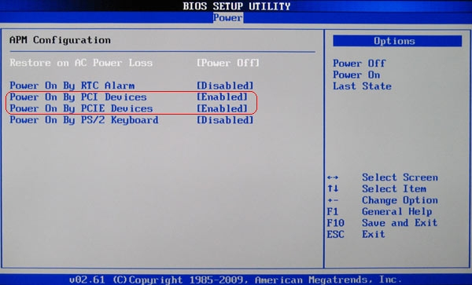
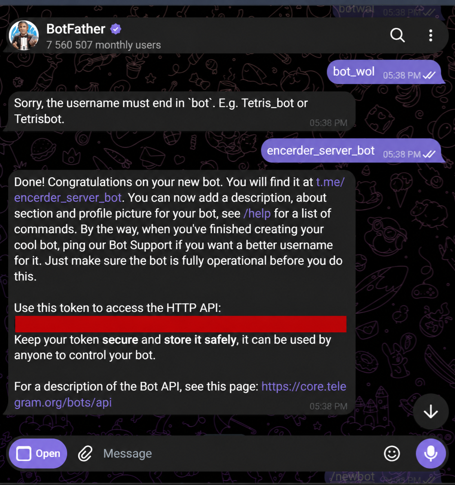
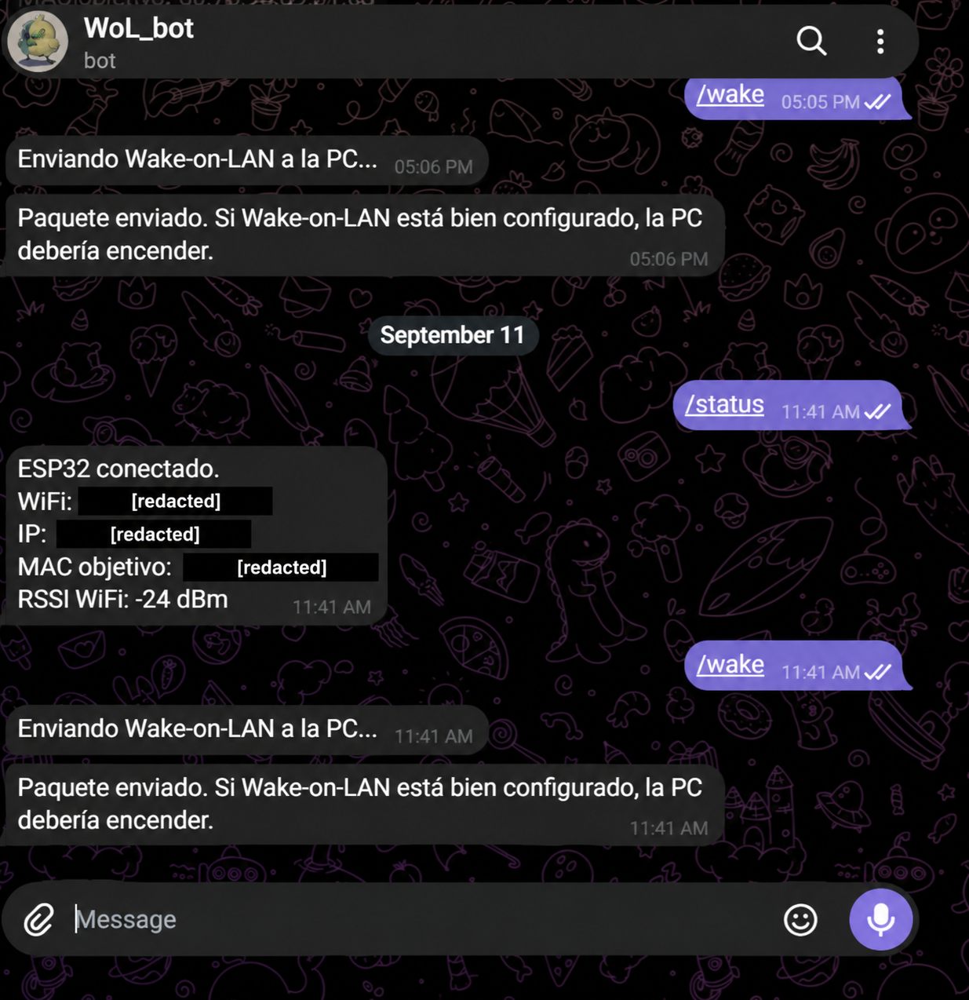

# Instalación y puesta en marcha

[Volver al inicio](../README.md) · [Funcionamiento del firmware](FUNCIONAMIENTO.md)

La ruta completa es **Telegram → internet → ESP32 por Wi-Fi → broadcast dentro de la LAN → tarjeta Ethernet de la PC**. El ESP32 necesita alimentación permanente, conexión Wi-Fi con salida a internet y acceso a la misma red local que la tarjeta que recibirá el paquete. La PC necesita una tarjeta compatible con Wake-on-LAN (WoL), conexión Ethernet y alimentación de espera. No se conecta el ESP32 eléctricamente a la PC ni se instala un relé.

## 1. Configurar la PC

### 1.1 Activar el despertar en BIOS/UEFI

Entra en la BIOS/UEFI de la placa madre y busca las opciones de encendido por red o dispositivos PCI/PCIe. En la placa fotografiada se habilitaron **Power On By PCI Devices** y **Power On By PCIE Devices**:

El nombre exacto varía según el fabricante. Puede aparecer como *Wake on LAN*, *Power on by PCI-E*, *Resume by LAN* o similar. Guarda los cambios antes de salir. Si pruebas el despertar desde apagado, comprueba también que la fuente y la placa mantienen alimentada la tarjeta de red en espera; una opción de ahorro extremo como ErP puede impedirlo. Empieza las pruebas desde **suspensión** antes de pasar a hibernación o apagado.

### 1.2 Habilitar el adaptador Ethernet en Windows

1. Conecta la PC por cable al router o switch de la LAN del ESP32.
2. Abre **Administrador de dispositivos → Adaptadores de red → tu adaptador Ethernet → Propiedades**.
3. En **Opciones avanzadas**, habilita **Wake on Magic Packet** o la opción equivalente del controlador.
4. En **Administración de energía**, permite que el adaptador reactive el equipo y, si está disponible, limita la reactivación a un paquete mágico.
5. Anota la **dirección física/MAC del adaptador Ethernet**. En PowerShell, `Get-NetAdapter -Physical | Format-Table Name, MacAddress, Status` ayuda a identificar el adaptador; también puedes verla con `ipconfig /all`.

Usa esa MAC, no la del Wi-Fi de la PC, la del router ni la del ESP32. Una MAC de ejemplo `AA-BB-CC-DD-EE-FF` se escribiría en el archivo local como `{0xAA, 0xBB, 0xCC, 0xDD, 0xEE, 0xFF}`. Ese ejemplo no identifica ningún equipo del proyecto.

Windows puede tratar de manera distinta la suspensión, la hibernación, el inicio rápido y el apagado completo. [Microsoft explica](https://learn.microsoft.com/en-us/troubleshoot/windows-client/setup-upgrade-and-drivers/wake-on-lan-feature) que el apagado híbrido/inicio rápido puede dejar el adaptador sin preparar para WoL, y que el despertar desde apagado completo depende también del hardware. Si funciona desde suspensión y falla desde apagado, revisa primero ese estado de energía y la configuración del fabricante.

## 2. Preparar el bot de Telegram

1. En Telegram, abre el [BotFather oficial](https://t.me/BotFather).
2. Envía `/newbot` y sigue las instrucciones para asignar nombre y usuario al bot.
3. Guarda el **token nuevo** en un lugar privado para colocarlo luego en `BOT_TOKEN`. Quien tenga el token puede controlar el bot: [Telegram recomienda tratarlo como contraseña](https://core.telegram.org/bots/tutorial).
4. Abre un chat privado con el bot recién creado y pulsa **Iniciar**. Lo usarás para obtener el identificador de chat y probar los comandos.

La imagen muestra la etapa de creación. La línea del token se ocultó completamente para que la captura pueda publicarse:

El material original de este proyecto contenía un token visible en el sketch y una captura. **Revócalo desde BotFather y usa uno nuevo** antes de desplegar esta versión. No reutilices el token expuesto ni incluyas el nuevo en fotos, incidencias o commits.

## 3. Completar `config.local.h`

### 3.1 Instalar el entorno

Instala Arduino IDE, el paquete **ESP32 by Espressif Systems** mediante el gestor de placas, la biblioteca [Universal Arduino Telegram Bot](https://github.com/witnessmenow/Universal-Arduino-Telegram-Bot) y su dependencia **ArduinoJson** mediante el gestor de bibliotecas. Selecciona después el modelo de tu ESP32 y su puerto serie. El proyecto usa `WiFi`, `WiFiClientSecure` y `WiFiUdp` del paquete de placas ESP32.

### 3.2 Crear el archivo privado

Copia `WoL/config.local.example.h` como `WoL/config.local.h`, junto a `WoL.ino`. Edita únicamente el nuevo archivo para los valores de tu instalación:

| Campo | Qué poner |
| --- | --- |
| `WIFI_SSID` | Nombre exacto de la red Wi-Fi a la que se conectará el ESP32 |
| `WIFI_PASSWORD` | Contraseña de esa red |
| `BOT_TOKEN` | Token nuevo entregado por BotFather |
| `ALLOWED_CHAT_ID` | Inicialmente `""`; después el ID numérico obtenido con `/id` |
| `PC_MAC_BYTES` | Seis bytes de la MAC Ethernet de la PC, en formato `0x..` |
| `WOL_BROADCAST_IP` | Dirección de broadcast de la subred local |

Por ejemplo, si **tu** red es `192.168.1.0` con máscara `255.255.255.0` (`/24`), su broadcast es `192.168.1.255`. La operación es `IP | ~máscara`: todos los bits de host quedan en `1`. No asumas `/24` si tu router usa otra máscara. Puedes ver IP y máscara en la configuración de red del router o de la PC. Con `192.168.2.42/23`, por ejemplo, el broadcast sería `192.168.3.255`.

El Wi-Fi del ESP32 y el puerto Ethernet de la PC deben alcanzar el mismo dominio de broadcast. Si el ESP32 está en una red de invitados, hay aislamiento de clientes/VLAN o el router no reenvía el broadcast a la PC, el paquete no llegará. Para el caso documentado, mantén ambos en la misma LAN. No hace falta abrir ni redirigir UDP/9 en el router hacia internet: el ESP32 consulta Telegram saliendo por HTTPS y genera UDP/9 **dentro** de la red local.

`config.local.h` está excluido mediante `.gitignore`. Comprueba esto antes de publicar cualquier copia o bifurcación del proyecto. La plantilla `config.local.example.h` contiene únicamente valores vacíos y ejemplos.

### 3.3 Emparejar el chat autorizado

1. Deja `ALLOWED_CHAT_ID` como `""` y carga el sketch al ESP32. En este modo sólo se atiende `/id`; **`/wake` permanece bloqueado**.
2. Desde el chat privado del bot, envía `/id`. Copia el número que devuelve el bot. No necesitas publicarlo.
3. Coloca ese número como cadena en `ALLOWED_CHAT_ID` dentro de `config.local.h`, recompila y vuelve a cargar el sketch.
4. A partir de ese momento, el firmware compara el ID de cada chat entrante con el configurado. Las solicitudes desde otro chat reciben `No autorizado.`

El modo inicial devuelve a cada interlocutor su propio ID de chat; úsalo sólo el tiempo necesario para emparejar. Si quieres usar un grupo en lugar de un chat privado, tendrías que obtener y autorizar el ID de ese grupo y adaptar el manejo de comandos si Telegram añade sufijos como `@nombre_del_bot`; el flujo probado aquí está planteado para un chat privado.

## 4. Cargar el firmware y verificar la conexión

1. Abre `WoL/WoL.ino` desde Arduino IDE. Compila y carga en la placa ESP32 seleccionada.
2. Abre el monitor serie a **115200 baudios**. Tras conectar al Wi-Fi, el programa muestra la IP local del ESP32 y el mensaje `Bot Telegram listo`.
3. Envía `/start` y `/status` desde el chat autorizado. `/status` informa de la conexión del **ESP32**, su SSID, IP local y potencia de señal (RSSI). No mide si la PC está encendida.
4. Pon la PC en suspensión y envía `/wake`. El bot responderá si la API UDP aceptó el paquete. Comprueba físicamente si la PC despertó.

Esta captura muestra los comandos de una ejecución del proyecto. Sus identificadores de red fueron ocultados y la respuesta de `/status` corresponde a una versión previa de la conversación; el firmware publicado muestra SSID, IP y RSSI del ESP32:

La respuesta de `/wake` **no verifica el encendido**: sólo indica el resultado de la operación de envío UDP. Si necesitas confirmación remota, debes añadir por separado una comprobación de presencia de la PC (por ejemplo, una respuesta de un servicio local). No forma parte de esta versión.

## 5. Diagnóstico

| Síntoma | Comprobación |
| --- | --- |
| El ESP32 no llega a `Bot Telegram listo` | Revisa SSID, contraseña, señal Wi-Fi y acceso a internet. El sketch espera la conexión Wi-Fi antes de iniciar el bot. |
| No responde ningún comando | Verifica el token renovado, el chat donde se envía el comando y la salida serie. Si activaste `TELEGRAM_ROOT_CA`, verifica también la CA y que el ESP32 pueda sincronizar la hora por NTP. |
| `/id` responde pero `/wake` pide configurar el chat | Completa `ALLOWED_CHAT_ID` con el número recibido, recompila y vuelve a cargar. |
| El bot responde `No autorizado.` | El chat desde el que escribes no coincide exactamente con `ALLOWED_CHAT_ID`. Comprueba si estás escribiendo desde un grupo o una cuenta distinta. |
| El bot dice que envió el paquete pero la PC no despierta | Verifica MAC Ethernet, broadcast y máscara; desactiva aislamiento entre Wi-Fi y Ethernet; prueba WoL desde otro dispositivo de la misma LAN; revisa BIOS/UEFI, controlador y alimentación de espera de la PC. |
| Funciona desde suspensión pero no desde apagado | Revisa inicio rápido, opciones de energía y soporte de la placa/adaptador para ese estado. No todos los equipos despiertan desde apagado completo. |
| Deja de responder después de perder Wi-Fi | Esta versión no implementa reconexión ni supervisión continua de la red; reinicia el ESP32 y comprueba la estabilidad de Wi-Fi. |

La documentación técnica detalla la [estructura exacta del paquete](FUNCIONAMIENTO.md#el-paquete-mágico) y el [tratamiento de cada comando](FUNCIONAMIENTO.md#comandos-y-autorización).
